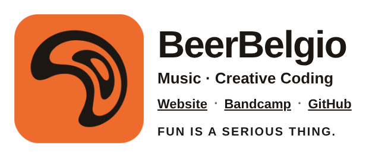
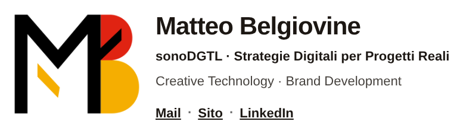
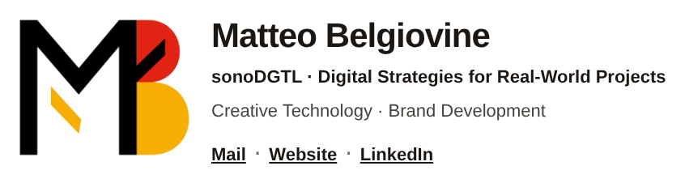

# BeerBelgio / sonoDGTL — Email signatures

Firme HTML minimali, con logo a sinistra e testo reale a destra. **Tre firme:** BeerBelgio in inglese, sonoDGTL in italiano e inglese.

## Anteprime

### BeerBelgio · EN



[Apri la firma](signatures/beerbelgio-en.html)

### sonoDGTL · IT



[Apri la firma](signatures/sonodgtl-it.html)

### sonoDGTL · EN



[Apri la firma](signatures/sonodgtl-en.html)

Le immagini qui sopra sono **solo anteprime**. Le firme sono HTML: testi selezionabili e link cliccabili. Nessuno sfondo pieno viene imposto.

## Struttura

```text
README.md
.nojekyll
signatures/
  beerbelgio-en.html
  sonodgtl-it.html
  sonodgtl-en.html
assets/
  beerbelgio-logo.png
  sonodgtl-monogram.png
previews/
  beerbelgio-en.png
  sonodgtl-it.png
  sonodgtl-en.png
```

Ogni file è parte del materiale da pubblicare: `signatures/` contiene le firme, `assets/` le immagini usate nei messaggi, `previews/` le anteprime del README e `.nojekyll` permette la pubblicazione statica diretta con GitHub Pages.

## Pubblicazione (necessaria prima dell'installazione)

1. Crea la repository pubblica `BeerBelgio/email-signatures`.
2. Carica **tutto il contenuto dello ZIP nella radice della repository**, non in una sottocartella aggiuntiva.
3. In **Settings → Pages** configura il deploy dal branch `main`, directory `/(root)`.
4. Attendi il completamento del deploy, poi controlla che questi indirizzi aprano direttamente le immagini, senza autenticazione:
   - https://beerbelgio.github.io/email-signatures/assets/beerbelgio-logo.png
   - https://beerbelgio.github.io/email-signatures/assets/sonodgtl-monogram.png
5. Apri nel browser le tre firme dalla repository pubblicata (`https://beerbelgio.github.io/email-signatures/signatures/beerbelgio-en.html`, ecc.) e verifica che le immagini compaiano. **Non usare le firme finché le immagini non sono accessibili.**

Gli URL pubblici delle immagini sono già configurati nei tre HTML. Pubblicare la repository da solo **non** attiva automaticamente GitHub Pages.

## Installazione

**Non incollare il sorgente HTML.** Apri la pagina HTML pubblicata nel browser, seleziona la firma visibile e copiala; poi incollala nell'editor delle firme del client.

- **Apple Mail (macOS)**: *Mail → Impostazioni → Firme*, scegli l'account, aggiungi una firma e incolla. Se Mail riformatta il contenuto, controlla l'opzione relativa al font predefinito del messaggio.
- **Gmail (web)**: *Impostazioni → Visualizza tutte le impostazioni → Generali → Firma*, aggiungi una firma e incolla. Se l'immagine scompare, reinserisci il PNG tramite **Inserisci immagine**, usando l'URL GitHub Pages verificato.
- **Outlook**: apri l'editor delle firme (la posizione varia tra Outlook classico, nuovo Outlook e Web), incolla la firma e reinserisci il PNG tramite l'editor se necessario.

Dopo l'installazione, invia **un messaggio reale** a un account diverso e controlla desktop/mobile, risposte, link e immagini bloccate. I browser non riproducono tutte le modifiche operate dai client di posta; Outlook classico può modificare spazi e font.

## Scelte editoriali e tecniche

- **BeerBelgio**: solo EN; niente nome anagrafico o email; *Music · Creative Coding*; link *Website · Bandcamp · GitHub*; claim **FUN IS A SERIOUS THING.** come testo HTML.
- **sonoDGTL**: nome *Matteo Belgiovine*; brand + claim in IT/EN; *Creative Technology · Brand Development*; solo *Mail · Sito/Website · LinkedIn*; nessun numero di telefono né indirizzo email visibile (il link *Mail* usa `mailto:`).
- Loghi: PNG derivati dagli SVG forniti dal titolare, senza ridisegno. **Non sono immagini contenenti il testo delle firme.**
- Nessun JavaScript, foglio CSS esterno, font remoto, pixel di tracking o sfondo di colore imposto. CSS inline e tabelle per migliorare la compatibilità.
- Immagini remote: quando caricate dal client comportano richieste HTTP al servizio hosting. Anche se non disponibili, tutto il testo utile rimane leggibile.
- Modalità scura: l'assenza di uno sfondo forzato è voluta, ma alcuni client cambiano autonomamente colori di testo e link. Non è garantito un rendering identico ovunque.

## Manutenzione

Modifica direttamente gli HTML in `signatures/`. Se cambi i testi, reinstalla la firma nel client e aggiorna la relativa immagine in `previews/`. Se cambi i loghi, sostituisci i PNG in `assets/` mantenendo il percorso, oppure aggiorna anche gli URL degli HTML. Conserva gli SVG originali nel tuo archivio sorgente per eventuali riconversioni.

Questa è una versione **pronta per la pubblicazione e il test di invio**, non un collaudo già superato in Apple Mail, Gmail e Outlook.

© BeerBelgio / sonoDGTL — Matteo Belgiovine. I marchi non sono rilasciati per riuso commerciale di terzi.
